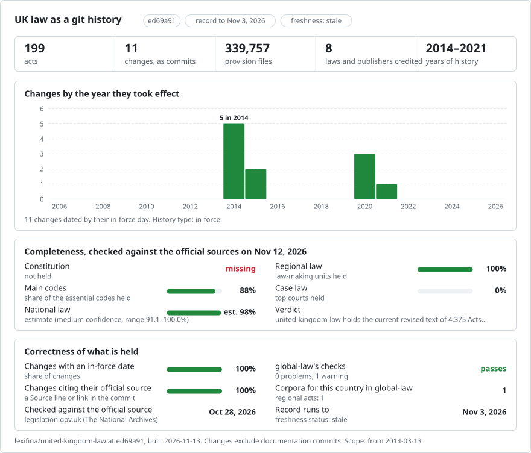

# United Kingdom: law history in git

<picture>
<source media="(prefers-color-scheme: dark)" srcset="data/effort-dark.svg">

</picture>

The law of the United Kingdom as a git history: one file per provision (section, regulation or schedule paragraph), one commit per version on the day it took effect, with that day in the commit's `In-force:` trailer. `git log` lists every version of a provision held here; `git blame` names the commit behind every line; picking a date gives the text in force that day.

Part of [lexifina/global-law](https://github.com/lexifina/global-law), one git history for every country's law: this is the United Kingdom's legislation, which global-law reads at `united-kingdom/uk/legislation/`.

**What is in it now:** 4,375 Acts in force, with 8,738 versions: 3,418 Acts of the UK Parliament (1801 to 2026) and 957 of the devolved legislatures (385 Acts of the Scottish Parliament; 42 Acts of the National Assembly for Wales, 33 Acts of Senedd Cymru and 19 Measures of the National Assembly for Wales; 274 Acts of the Parliament of Northern Ireland, 202 Acts of the Northern Ireland Assembly and 2 Measures of the Northern Ireland Assembly). 438 Acts of the UK Parliament from 2010 on also have their earlier versions, most from Royal Assent; the others are their current text only. It also holds nine provisions on education, health and care (EHC) plans, Children and Families Act 2014 ss. 19, 21, 36, 37 and 42 and SEND Regulations 2014 regs. 6, 11, 12 and 13, with all 26 of their versions since 2014. [`data/acts.csv`](data/acts.csv) lists every Act, the day its text starts and the changes legislation.gov.uk has not yet applied to it.

Each Act is a folder at the path of its legislation.gov.uk address, with one file per provision and a `README.md` listing its contents (`ukpga/1996/18/` is the Employment Rights Act 1996, 1996 c. 18; `ukpga/1996/18/section/1.md` is its section 1); Acts before 1963 are numbered by regnal year (`ukpga/Will4and1Vict/7/26/` is the Wills Act 1837).

The text is in English, as legislation.gov.uk publishes it; a short header in each file gives the provision's status and the point-in-time version it is taken from.

## Questions as git commands

| Question | Command |
| --- | --- |
| Every change to s. 37 of the Children and Families Act 2014 (EHC plans) | `git log -p --word-diff -- ukpga/2014/6/section/37.md` |
| Which instrument wrote each line of s. 37? | `git blame ukpga/2014/6/section/37.md` |
| Every version of the Employment Rights Act 2025, with the day each took effect | `git log --format="%h %(trailers:key=In-force,valueonly,separator=) %s" -- ukpga/2025/36` |
| Section 1 of the Employment Rights Act 2025 on 1 January 2026, before it came into force | `python tools/ukhistory.py on 2026-01-01 ukpga/2025/36/section/1` |

**Outside git**, we also host this record publicly, for free:

- **[Ask Claude about UK law](https://global-law.lexifina.com/v1/try_claude?country=united-kingdom)**: opens Claude with a first question ready.
- **[Ask ChatGPT](https://global-law.lexifina.com/v1/try_chatgpt?country=united-kingdom)**: the same question in ChatGPT.
- **[Call the API in your browser](https://global-law.lexifina.com/v1/search_law?query=annual+leave&jurisdictions=united-kingdom)**: a search of UK law for "annual leave", returned as JSON. See the [documentation here](https://lexifina.com/api/global-law).

Both assistants read the record through the free Global law connector (MCP, `https://global-law.lexifina.com/mcp`); the first time, the chat gives you the link that adds it. Ask in English.

**Host it yourself easily.** All it takes is git and Python, and the tools run on your machine:

```sh
git clone --depth 1 https://github.com/lexifina/global-law && cd global-law
python3 tools/countries.py add united-kingdom/uk/legislation
python3 tools/law.py show 2026-11-14 united-kingdom/uk/legislation/ukpga/1996/18/section/1.md
```

Opened in Claude Code, Cursor, VS Code or Codex, the clone also starts a local MCP server with the same tools ([MCP.md](https://github.com/lexifina/global-law/blob/main/MCP.md)).

## Dates

Each commit is dated at noon, Europe/London, on the day the version took effect, and carries it in its `In-force:` trailer:

- for the nine EHC provisions, the day each change came into force, from legislation.gov.uk's point-in-time versions and its changes register; coming into force is itself a commit, which changes the file's `status:` line, and `Enacted:` or `Made:` give the instrument's other dates;
- for an Act, the day its current text took effect (the start of legislation.gov.uk's latest point-in-time version), or Royal Assent for a recent Act it has not yet revised; each earlier version of the 438 Acts is dated by its own point-in-time version;
- git cannot store dates before 1970, so the 698 Acts whose text took effect earlier are dated from 1 January 1970, one second apart, with the real day in `In-force:`. The Acts' commit dates are the days they were added, so ask for a date with `tools/ukhistory.py`, not `git log --before`.

Each change to the nine EHC provisions is credited to the instrument that made it (`S.I. 2020/471 (The Special Educational Needs and Disability (Coronavirus) (Amendment) Regulations 2020)`), at an address ending `.invalid`. The Acts' commits are credited to `Lexifina`; their messages name the laws that the publisher's changes register dates to that day (`Affecting:`).

## How it is checked

- `python tools/ukhistory.py check` fetches every version of the nine EHC provisions again from legislation.gov.uk and compares it with the history; on 28 October 2026 all matched, and a rebuild from `data/history.json` gave the same 11 law commits with the same hashes ([`REPRODUCE.md`](REPRODUCE.md)).
- `tools/test_ukhistory.py` runs 15 tests of the build script, with five saved versions of the publisher's XML (`tools/fixtures/`).
- Before each batch of Acts was pushed, every Act and version in it was read back from git and compared with the text taken from legislation.gov.uk: 0 mismatches and 0 trailer errors in all 30 batches. That builder is not in this repository, and `REPRODUCE.md` describes the nine provisions only.
- Each file's `source:` line and each commit's `Source:` trailer link the point-in-time version on legislation.gov.uk that the text is taken from.

## What it does not show

- **Earlier versions of most Acts.** 3,937 Acts are their current text only, so the history does not say when each provision took its present words; before an Act's first commit it has no text for it, which does not mean the Act was not law.
- **Acts legislation.gov.uk has not revised, and repealed Acts.** Of the 17,561 UK Public General Acts it lists, 13,253 it has not revised (all before 2025) are left out, as are wholly repealed Acts and the Acts of the Parliaments of England, Scotland, Great Britain and Ireland before 1801.
- **Changes not yet applied.** legislation.gov.uk applies changes weeks or months after they take effect; `data/acts.csv` counts 26,007 it had not yet applied to these Acts when they were read.
- **Changes that leave the words alone**, such as modifications, transitional and saving provisions: they are named in commit messages at most.
- **Secondary legislation and case law.** No statutory instruments apart from the four SEND regulations, and no court decisions. The UK has no codified constitution; constitutional statutes such as the Human Rights Act 1998 and the Scotland Act 1998 are here as Acts.

## Sources

| Source | Kind | Past versions | Notes |
| --- | --- | --- | --- |
| [legislation.gov.uk](https://www.legislation.gov.uk) (The National Archives) | Official legislation, revised | yes, point-in-time versions | The text of each version, the day it took effect, and the changes register, with the changes not yet applied |

## Licence

See [`LICENSE.md`](LICENSE.md). The legislation is © Crown and database right, derived from content available under the Open Government Licence v3.0 from legislation.gov.uk; this history is not endorsed by The National Archives or legislation.gov.uk. The history, commit messages and README are CC BY 4.0, and `tools/ukhistory.py` is under the MIT licence.

No AI model wrote or edited legal text; the code and documentation were written by an AI model (see [`REPRODUCE.md`](REPRODUCE.md)).

## More

From [lexifina/global-law](https://github.com/lexifina/global-law):

- [FEATURES.md](https://github.com/lexifina/global-law/blob/main/FEATURES.md): every feature, and what every corpus must support (`git blame`, `law.py`, the MCP tools)
- [FAQ.md](https://github.com/lexifina/global-law/blob/main/FAQ.md): questions and answers · [CONTRIBUTING.md](https://github.com/lexifina/global-law/blob/main/CONTRIBUTING.md): proposing changes · [MCP.md](https://github.com/lexifina/global-law/blob/main/MCP.md): the MCP server · [REPRODUCE.md](https://github.com/lexifina/global-law/blob/main/REPRODUCE.md): how it was built · [CHANGELOG.md](https://github.com/lexifina/global-law/blob/main/CHANGELOG.md)
- [FRESHNESS.md](https://github.com/lexifina/global-law/blob/main/FRESHNESS.md): how current each corpus is · [Monitoring](https://github.com/lexifina/global-law/tree/main/monitoring): whether updates are running · [WATCHING.md](https://github.com/lexifina/global-law/blob/main/WATCHING.md): how each official source is watched for changes
- [performance/](https://github.com/lexifina/global-law/tree/main/performance): how fast the tools are, measured
- [visualisations/](https://github.com/lexifina/global-law/tree/main/visualisations): charts and bridges across the world's law
- [Vulnerabilities](https://github.com/lexifina/global-law/tree/main/vulnerabilities): mistakes in legislation as published
